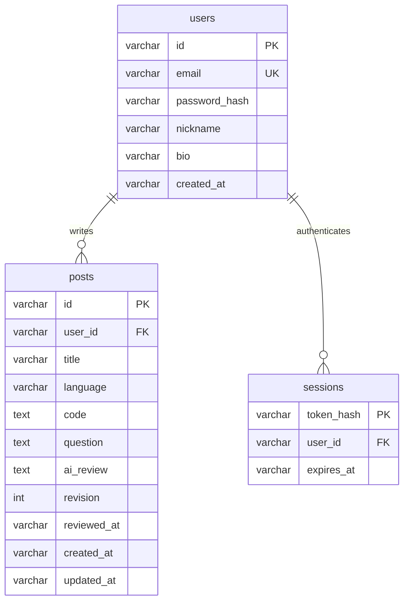

# Codegarden · AI 코드 리뷰 커뮤니티

React + Vite / Express / MySQL 8+ / bcrypt / OpenAI Responses API로 만든 수행평가 프로젝트입니다. 회원가입, 로그인, 프로필 수정, 회원 탈퇴, 게시글 CRUD, 작성자 권한, JOIN 목록과 개발자별 집계 메뉴를 포함합니다.

## 현재 MySQL 연결 (설정 완료)

- 새 서버: `127.0.0.1:3307` (기존 3306 서버와 별개)
- 앱 계정: `20618`
- 데이터베이스: `jiwonproject_20618`
- 비밀번호: 제공한 Downloads/env의 DB_PASSWORD를 프로젝트 `.env`에 적용
- Workbench 연결 이름: `Codegarden 20618 (새 서버)`
- 테이블: users, posts, sessions 생성 및 JOIN 확인 완료
- 기존 SQLite 회원 3명/게시글 6개를 이전했으며 SQLite 원본은 보존
- 맥 로그인 시 MySQL이 자동 실행됨: `local.codegarden.mysql`
- MySQL 데이터 위치: `/Users/choijiwon/Library/Application Support/Codegarden/MySQL`
- 새 root 관리자 비밀번호는 프로젝트 `.env.mysql-admin`에 저장(소유자만 읽기 가능, Git 제외). 공유하거나 제출하지 마세요.

```sh
cd /Users/choijiwon/Desktop/codegarden
npm run db:check
npm run dev
```

서버 포트는 3001이며 프론트 화면은 http://127.0.0.1:5173 입니다. `npm run dev:demo`는 다시 SQLite로 실행하는 명령이므로 현재는 `npm run dev`를 사용하세요.

MySQL 서비스 관리:

```sh
launchctl kickstart gui/$(id -u)/local.codegarden.mysql
launchctl bootout gui/$(id -u)/local.codegarden.mysql
# 중지한 뒤 다시 등록
launchctl bootstrap gui/$(id -u) ~/Library/LaunchAgents/local.codegarden.mysql.plist
```

Downloads/env 원본은 변경하지 않았습니다. 원본 포트 3306 대신 프로젝트 `.env`의 3307을 사용하세요. JWT_SECRET은 필요 없는 DB 세션 로그인 방식입니다.

## 1. 설치

Node.js 22.13 이상(현재 맥의 Node 25 사용 가능)이 필요합니다.

```sh
npm install
```

프로젝트 최상위 `.env` 파일을 편집하세요. `.env.example`은 비밀값 없는 템플릿이며 `.env`는 Git에서 제외되어 있습니다.

```dotenv
DB_CLIENT=mysql
DB_HOST=127.0.0.1
DB_PORT=3306
DB_USER=root
DB_PASSWORD=본인의_MySQL_비밀번호
DB_NAME=codegarden
OPENAI_API_KEY=본인의_OpenAI_API_키
OPENAI_MODEL=gpt-4.1-mini
PORT=3001
APP_ORIGIN=http://localhost:5173
```

키와 비밀번호는 서버에서만 읽습니다. `VITE_` 접두사를 붙이지 마세요. 프로젝트에는 실제 키나 DB 비밀번호가 들어 있지 않습니다. OpenAI 모델은 계정에서 사용 가능한 Responses API 모델로 변경할 수 있습니다.

## 2. MySQL DB 만들고 실행

MySQL 서버를 시작한 상태에서 실행합니다. Workbench는 관리 도구이므로 MySQL 서버 자체도 실행되어 있어야 합니다.

```sh
npm run db:init
npm run db:seed
npm run dev
```

`db:init`은 지정한 데이터베이스와 테이블이 없을 때 생성합니다. 기존 데이터베이스를 지우지 않습니다. 계정에 DB 생성 권한이 없다면 관리자가 `sql/schema.sql`을 적용하고, 생성된 DB에 접근 가능한 계정을 설정하세요.

브라우저에서 http://localhost:5173 을 엽니다. 직접 회원가입 후 코드 공유 → 상세 화면 → AI 리뷰 요청 순서로 사용할 수 있습니다. `db:seed`는 선택 사항이며 가상의 학습용 게시글 6개를 추가합니다. 샘플 계정은 로그인용이 아니며 실제 AI 리뷰는 생성하지 않습니다.

## 3. DB 설정 전 SQLite로 미리 실행

SQLite도 실제 SQL 데이터베이스이며 데이터는 `data/codegarden.sqlite`에 유지됩니다. 이 명령들은 `.env`의 MySQL 기본 설정을 변경하지 않습니다.

```sh
DB_CLIENT=sqlite npm run db:seed
npm run dev:demo
```

MySQL과 SQLite는 서로 다른 저장소이며 데이터가 자동 이동하지 않습니다. AI 키 없이도 회원/게시글 기능을 사용할 수 있지만, AI 리뷰를 요청하면 연결 안내가 나타납니다. 가짜 AI 응답은 표시하지 않습니다.

## 수행평가 대응표

| 요구사항 | 구현 위치 / 화면 |
|---|---|
| 회원 Create | 회원가입 / POST /api/auth/register / bcrypt cost 12 |
| 회원 Read | 로그인, 마이페이지 / POST /api/auth/login, GET /api/auth/me |
| 회원 Update | 마이페이지 닉네임·소개 / PATCH /api/users/me |
| 회원 Delete | 비밀번호 재확인 후 탈퇴 / DELETE /api/users/me |
| 핵심 Create | 로그인 후 코드 공유 / POST /api/posts |
| 핵심 Read | 전체 코드, 상세 페이지 / GET /api/posts, GET /api/posts/:id |
| 핵심 Update | 작성자만 수정 / PATCH /api/posts/:id |
| 핵심 Delete | 작성자만 삭제 / DELETE /api/posts/:id |
| JOIN 메뉴 | 전체 코드: posts INNER JOIN users, 작성자 닉네임 표시 |
| 추가 JOIN 메뉴 | 개발자들: users LEFT JOIN posts, 글·AI 리뷰 수 집계 |

## 데이터베이스 구조



회원과 게시글이 핵심 두 테이블이고 sessions는 로그인 유지용 보조 테이블입니다. 탈퇴 시 외래키 ON DELETE CASCADE로 글과 세션도 삭제합니다. 날짜는 정렬과 SQLite 호환을 위해 UTC ISO 8601 문자열로 저장합니다.

전체 코드 화면의 JOIN:

```sql
SELECT p.*, u.nickname AS author, u.bio AS author_bio
FROM posts p
JOIN users u ON p.user_id = u.id
ORDER BY p.created_at DESC;
```

개발자들 화면의 JOIN:

```sql
SELECT u.id, u.nickname, u.bio,
       COUNT(p.id) AS post_count,
       SUM(CASE WHEN p.ai_review IS NOT NULL THEN 1 ELSE 0 END) AS review_count
FROM users u LEFT JOIN posts p ON u.id = p.user_id
GROUP BY u.id, u.nickname, u.bio
ORDER BY post_count DESC;
```

## 보안 및 AI 동작

- bcrypt 해시만 저장하며 비밀번호 원문은 저장하지 않습니다. bcrypt 특성상 72바이트 초과 비밀번호는 거절합니다.
- 로그인 쿠키는 HttpOnly, SameSite=Lax이며 만료는 7일입니다. DB에는 세션 토큰의 SHA-256 해시를 저장합니다.
- 서버에서 작성자 ID를 검사합니다. 요청 본문의 user_id를 신뢰하지 않습니다.
- SQL은 바인딩 파라미터를 사용하며, JSON 본문·코드 길이·로그인/AI 요청 빈도를 제한합니다.
- AI는 코드를 실행하지 않습니다. 작성자가 리뷰를 요청할 때만 코드와 질문을 OpenAI로 전송합니다. `store:false`를 지정하지만 제공자의 별도 데이터 처리 정책까지 무보관으로 보장하지 않습니다.
- 리뷰는 Markdown으로 저장하고 HTML을 실행하지 않는 뷰어로 표시합니다. 코드 수정 시 기존 리뷰를 지우며, 리뷰 도중 수정된 코드는 revision 비교로 오래된 결과 저장을 막습니다.
- AI 생성 버튼은 작성자에게만 표시합니다. 코드·질문·AI 결과는 공개되므로 비밀정보를 올리지 마세요.
- 개발 서버는 로컬에서만 접근합니다. 외부 서비스로 배포할 경우 HTTPS, 올바른 APP_ORIGIN, 운영 DB 계정, 프록시 설정, 모니터링을 구성하세요. NODE_ENV=production의 쿠키는 Secure이므로 HTTPS가 필요합니다.

## 검증 / 빌드

```sh
npm test
npm run build
```

기본 테스트는 임시 SQLite DB를 사용하며 실제 사용자 데이터를 건드리지 않습니다. MySQL 검증은 전용 빈 테스트 DB를 만들고 `TEST_DB_CLIENT=mysql DB_NAME=codegarden_test npm test`로 실행할 수 있습니다.

```sh
npm run build
npm start
```

운영 모드에서는 빌드된 React 화면을 Express가 제공합니다. HTTPS 프록시와 APP_ORIGIN을 설정하세요. 개발 시에는 `npm run dev`를 사용하세요.

## 주요 파일

- `src/main.jsx`: 목록, 작성, 상세/AI 리뷰, 회원가입/로그인, 마이페이지
- `src/style.css`: 반응형 화면 디자인
- `server/app.js`: API, 권한, 인증, OpenAI 리뷰
- `server/db.js`: MySQL / SQLite 어댑터, 테이블 초기화
- `sql/schema.sql`: 제출용 MySQL DDL
- `tests/api.test.js`: 인증·CRUD·JOIN·권한·리뷰 충돌·탈퇴 테스트

OpenAI 구현 참고: https://developers.openai.com/api/docs/quickstart
